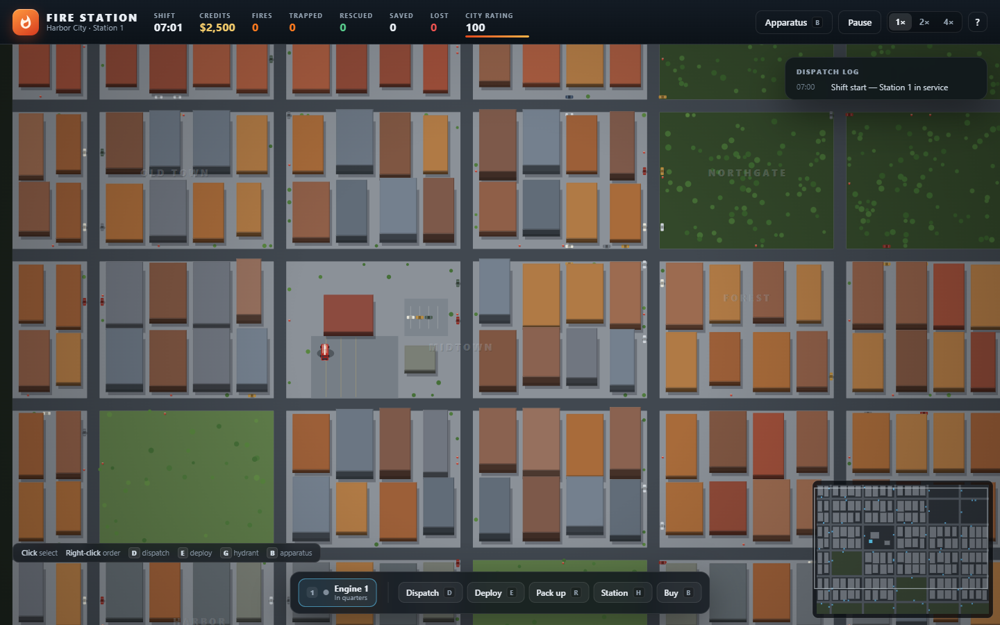
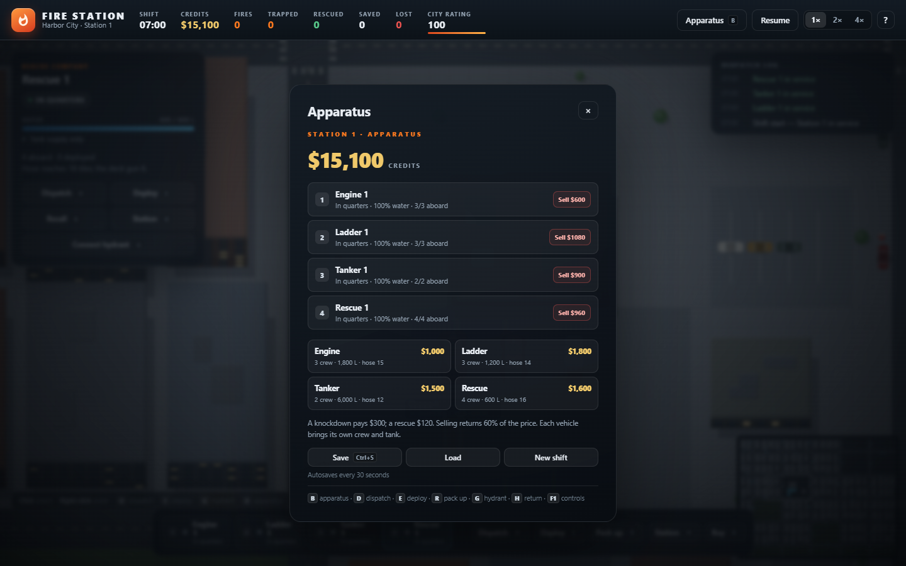
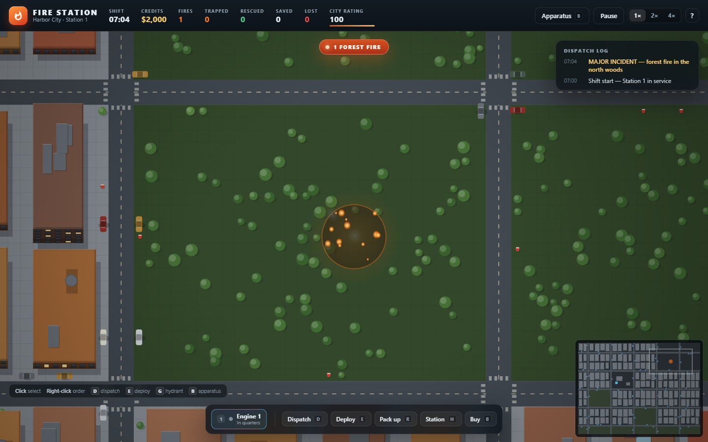
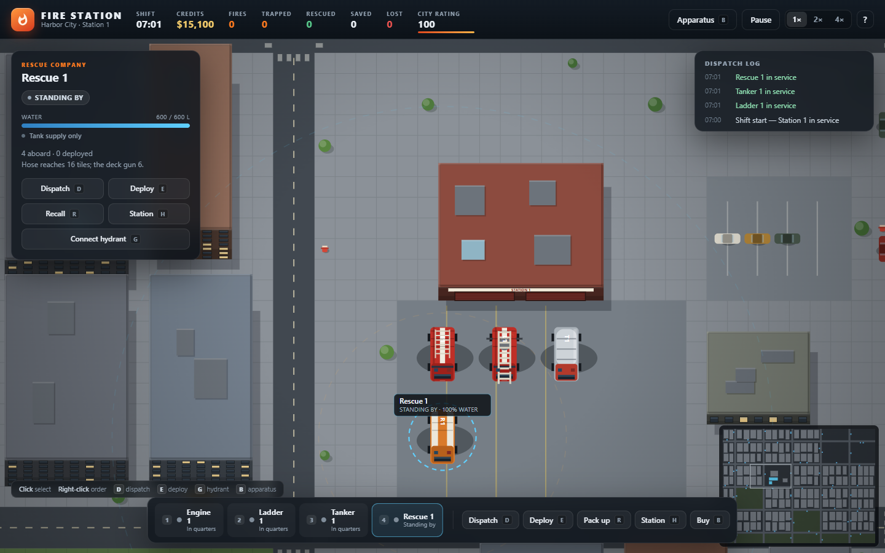
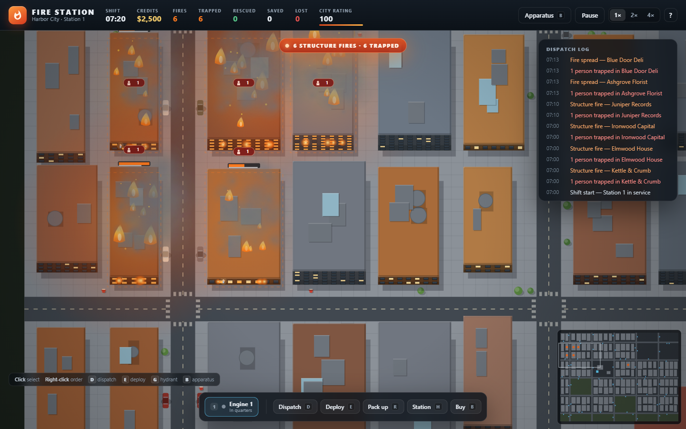
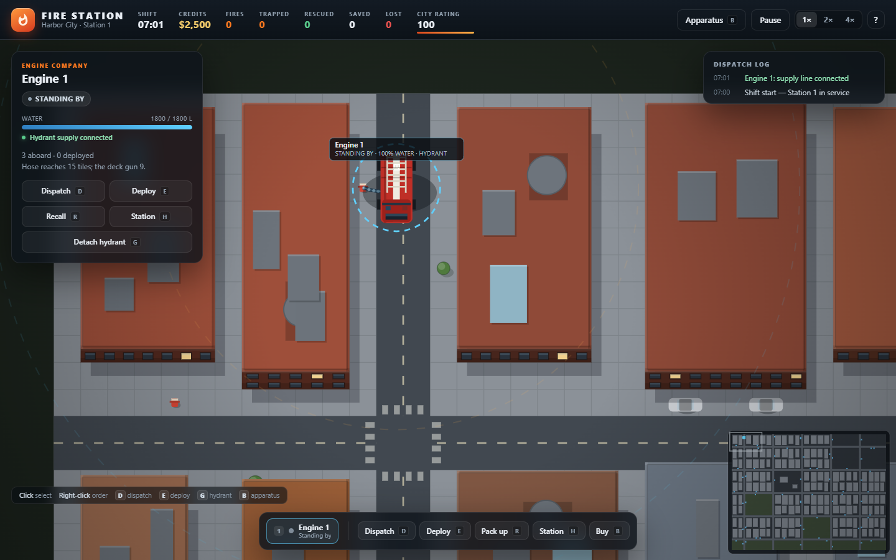

# Fire Station — Harbor City

A top-down emergency-services management game for Windows, in the spirit of **Emergency 4**: a
520×384 city (ten times the area of the first version) with forests, pharmacies and a waterfront,
a fleet of thirteen kinds of apparatus you buy and sell — engines, ladders, tankers, rescue units,
paramedic cars, ambulances and ambulance buses, divers, fireboats, a helicopter, an air tanker and
**ambulances** — small calls and major incidents, injured civilians, forest fires, a real budget,
synthesised sound, hospitals, blocked roads with live traffic, wind that drives the fire, chained incidents and a day/night cycle. Vanilla JavaScript, no dependencies; one self-contained
`index.html`.



> **شروع سریع:** روی `index.html` دوبار کلیک کنید. بازی بدون سرور، بدون نصب و بدون فایل exe
> اجرا می‌شود — همه‌ی کد و استایل داخل همان یک فایل HTML است.

## Running it

**Double-click `index.html`.** That is the whole game: one self-contained file with the JavaScript
and CSS inlined, so it runs straight from `file://` with no server, no Node and nothing installed.

`index.html` is generated. To change the game, edit `src/`, `styles/` or the markup between the
`build:` markers in `index.html`, then rebuild:

```powershell
node tools/build.mjs     # rebuild index.html from src/ and styles/
npm test                 # or: node --test test/
```

Node 18+ is only needed for the build and the tests; playing needs nothing but a browser.

## The shift

You command **Station 1** in Harbor City: about 1,800 buildings, 570 hydrants, 48 pharmacies, eight
forests, and **$3,000** to start. One engine and three firefighters are in quarters. Calls come in;
you send what fits, lay hose, pull people out, treat the injured, and spend what you earn on more
apparatus. The first calls come from near the station; the area the calls cover grows through the
shift until it reaches the whole map.

There is **no lose state**. The city rating is a score that falls when buildings are lost and
recovers when you save them; at zero the shift still goes on. Only the clock and your wallet limit
the night.

| | |
|---|---|
| **Respond** | Select a vehicle (click it or press <kbd>1</kbd>–<kbd>6</kbd>) and right-click a fire. It takes the fastest road route and parks on the nearest street. With nothing selected, <kbd>D</kbd> sends the nearest idle vehicle. |
| **Deploy** | The crew ride along. On scene they dismount, walk to the fire and attack it on their own. <kbd>E</kbd> deploys them by hand, <kbd>R</kbd> packs them up. |
| **Rescue** | A fire leaves people trapped — a red badge on the building shows how many. A crew at the building brings one person out at a time. If it collapses first, they are lost. Small rescue jobs exist too. |
| **Headquarters** | <kbd>B</kbd> opens a three-tab panel: **Fleet** (buy and sell, pick which station gets the vehicle, open Station 2 and the Harbour Dock), **Finance** and **Contracts**. |
| **Injured** | People hurt in a fire lie on the street with a countdown ring and a red cross. Right-click them or press <kbd>D</kbd> with an ambulance selected. Medical emergencies also come in as calls of their own. |
| **Pharmacy** | An ambulance carries 8 medical kits (one per patient). Restock slowly and free on the station apron, or fast beside any pharmacy for $12 a kit. <kbd>P</kbd> sends the selected ambulance to the nearest one. |
| **Hospital** | Each base has its own hospital beside the apron (Station 2's opens with the station). A **critical** patient (flagged on their card) is stabilised on the spot, put on a stretcher (two per ambulance, eight on a bus) and driven to the base hospital automatically, for $260 each. <kbd>K</kbd> sends the ambulance by hand. **When an ambulance has finished its work it drives back to the base hospital by itself.** |
| **Roads** | Wrecks and debris **block the street**: those tiles are closed to the fleet until a deployed crew clears them (rescue units twice as fast). Engines on the move re-plan round a new blockage. Traffic fills every avenue, queues behind a wreck, and in rush hour (07–09 and 16:30–18:30) slows your response by 20%. |
| **Wind** | The top bar shows the wind. Fire spreads up to ~2.5× as often downwind and barely crosses upwind; a forest fire creeps downwind and throws embers further that way; smoke and sparks lean with it. It shifts every few minutes. |
| **Find it** | <kbd>Tab</kbd> jumps to the next incident (fire, forest fire, trapped people or an injured person), <kbd>Home</kbd> back to the station. Off-screen incidents get an arrow on the edge of the screen and a dot on the minimap. |
| **Hose** | Water only flows within the vehicle's hose range — the dashed circle around it. |
| **Hydrant** | Park within reach of a hydrant and press <kbd>G</kbd>. A supply line runs to the pump and the tank stays fed while the crew works. Drive off and it detaches. |
| **Water** | Tanks run from 600 L (rescue) to 6,000 L (tanker). The station apron refills; anywhere else you need the hydrant line. |
| **Calls** | Small jobs start arriving after 20 seconds, roughly every 38–60, about one in five a medical emergency. **Major incidents start after four minutes** and pay far more. |
| **Night** | The shift starts at 07:00. Dusk comes at 18:00 and it is dark from 21:00 to 05:00. |
| **Save** | The shift autosaves every 30 seconds. <kbd>Ctrl</kbd>+<kbd>S</kbd> saves by hand; Headquarters has Save, Load and New shift. A saved shift appears as **Continue** on the start screen. |

### Apparatus and credits

| Vehicle | Crew | Water | Hose | Deck gun | Price | Upkeep/h |
|---|---|---|---|---|---|---|
| **Engine** | 3 | 1,800 L | 15 | 9 | $1,000 | $24 |
| **Ladder** | 3 | 1,200 L | 14 | 18 | $1,800 | $36 |
| **Tanker** | 2 | 6,000 L | 12 | 7 | $1,500 | $26 |
| **Rescue** | 4 | 600 L | 16 | 6 | $1,600 | $30 |
| **Ambulance** | 2 paramedics | 8 kits | walks 22 tiles | — | $1,400 | $22 |
| **Command** | 2 | — | — | — | $2,600 | $40 |
| **Helicopter** | none | 2,600 L | — | 11 (from the air) | $8,000 | $95 |
| **Air tanker** | none | 5,000 L | — | 8 (circling) | $11,000 | $140 |
| **Fireboat** | none | unlimited | — | 18 (from the water) | $6,200 | $70 |
| **Rescue boat** | 2 divers | — | — | — | $2,800 | $34 |
| **Dive team** | 2 divers | — | — | — | $2,300 | $30 |
| **Paramedic car** | 1 paramedic | 4 kits | walks 18 tiles | — | $750 | $12 |
| **Ambulance bus** | 4 paramedics | 16 kits, 8 stretchers | walks 24 tiles | — | $3,400 | $48 |

- **Command car:** no hose, no water. Parked, it makes every crew within 26 tiles spray 20% harder.
- **Helicopter:** flies in a straight line over roads, wrecks and traffic and hovers over the target, dropping water on buildings and forest fires alike. It refills on any station apron or by dipping in the harbour (the south edge of the map), so it is fast but never close to the water. It is the first choice when you right-click a forest fire.
- **Station 2:** a second station in the Civic Quarter, for sale at $9,000. It adds eight bays and a second helipad, its apron refills and restocks like Station 1's, and calls begin to come from its district too.


Selling returns 60% of the price. Every incident carries its own reward:

| Incident | Reward |
|---|---|
| Structure fire | $300 |
| Block fire | $600 |
| Person trapped | $350 |
| Industrial fire (major) | $1,500 |
| Major block fire | $1,800 |
| Forest fire (major) | $2,200 |

### Finance

The **Finance** tab holds the levers:

- **Loans** in $5,000 steps up to $30,000, at 3% of what you owe per game hour.
- **Insurance** for $70 an hour: a lost building costs 40% instead of all of it.
- **Training** for fire attack, paramedics and rescue, three levels each (+12% spray power, 15% faster treatment, 12% faster rescue per level).
- A breakdown of everything you earned and spent this shift, and a **day report** in the log every midnight.

**Contracts:** every five to eight minutes a sponsor offers a side job (knock down N fires, treat N people, reopen N roads, deliver critical patients, or go a stretch with no casualties). Accept up to two; finish in time and they pay, miss the deadline and you forfeit a quarter of the fee.

### Water: the river, the harbour and the dock

The south of the map is the **harbour** and a **river** runs down through the east, crossed by every street on a bridge. People go into the water (a car off a bridge, someone off the quay) and have about 80–130 seconds.

- **Dive team** drives to the bank and its divers swim out; the **rescue boat** sails to the casualty and puts them over the side. Right-click the person (or press <kbd>D</kbd> with a diver vehicle selected). Someone brought out is a critical patient: the ambulances and the hospital take over.
- **Fireboat** pumps river or harbour water without limit from 18 tiles out, but only works fires near the water. **Air tanker** circles a fire dropping water and skims the sea to refill. Both are strong, and neither is any use inland.
- Boats berth at the **Harbour Dock** ($6,500, eight berths on the quay), which has to be bought first.
- A fire that nobody is fighting spreads more and further the longer it burns dry, and is flagged **out of control** after a minute. Get water on it early.

### Chained incidents

One call can become several if you are slow:

- **Traffic accident** – a wreck blocks the road, one to three people are hurt, and the fuel is leaking. After 45–80 seconds it **sets the nearest building alight** (a fire worth $700 on its own). Clear the wreck first and it never happens, and you earn a quick-clearance bonus.
- **Pile-up** (major) – several wrecks in a row on one road, four to six injured, the same fuse on each.
- **Explosion** – a warehouse fire that runs hot (over 85%) can blow up: two neighbours catch, two bystanders are hurt and debris closes the street in front.
- **Forest fire** – embers light the buildings it reaches, further downwind.

### The money

There is a real budget, shown in the top bar and in Headquarters.

- **Income:** incident rewards (with up to **+50% for a fast knockdown**), a knockdown fee of $260
  scaled by what the building is worth (a hotel pays 1.8× a shop, a house 0.8×), $120 per rescue, $160
  per treated patient, the odd community donation, and an **hourly city subsidy** of $260 that shrinks to
  40% as the city rating falls.
- **Costs:** every game hour (two real minutes) the city deducts the **upkeep** of every vehicle (there are no crew wages). A lost building costs $350 (scaled the same way), a life $700, and kits
  bought at a pharmacy $12 each.
- The balance can go negative; you just cannot buy anything until it recovers. A full eight-bay fleet
  costs more than the subsidy pays, so it has to earn its keep.



### Major incidents and the forest

After the first four minutes the city can throw a **major incident**: an industrial fire, a
multi-building block fire, or a forest fire in one of the woods. Only one major incident is live at a
time, and the small calls keep coming in the background.

The biggest woodland is the **Southeast Forest**: a pine forest of twenty-five blocks east of the river,
from the Eastside district down to the quay. The roads through it are country roads with grass verges,
no street lamps and no parked cars, and it is a long drive from Station 1, so a fire there is a job
for the helicopter or the air tanker first.

A forest fire is an area, not a building. It grows, throws embers into any building it reaches, and
has to be fought on foot from the tree line: park on the nearest street, deploy the crew, and let
them work the edge. The deck gun can reach from the road if you get close enough. Select the fire on
the map (or click the smoke) to see its size, intensity and reward, and press **Dispatch**.



### Sound

All sound is synthesised in the browser (no audio files): fire crackle, hose water, city wind, an engine
hum, sirens that wail for fire apparatus and yelp for ambulances (positioned left and right by where the
vehicle is on screen and quieter the further it is from the camera), station tones for a new call, a
klaxon for a major incident, chimes and a till for money, a boom when a building comes down, radio chirps
when you give an order. <kbd>M</kbd> or the Sound button mutes it; the setting is remembered. Browsers only
allow audio after a click or key press, so it starts with your first one.

### Shortcuts are on screen

Every action button carries its key, the roster numbers the vehicles, and a strip in the bottom-left
lists the pointer controls. <kbd>F1</kbd> opens the full list.

### Controls

| Input | Action |
|---|---|
| Left click | Select a vehicle, a crew member, a building, a wildfire, a wreck or an injured person |
| Right click | Send the selected unit there; on a burning building, wildfire, wreck or injured person, dispatch |
| Drag / arrow keys | Pan the map |
| Scroll | Zoom around the pointer |
| <kbd>1</kbd>–<kbd>8</kbd> | Select a vehicle |
| <kbd>D</kbd> | Dispatch the selected vehicle (or the nearest idle one); an ambulance goes to the nearest patient |
| <kbd>P</kbd> | Send the selected ambulance to the nearest pharmacy |
| <kbd>K</kbd> | Send the selected ambulance to the nearest hospital with its patients |
| <kbd>Tab</kbd> / <kbd>Home</kbd> | Next incident / back to Station 1 |
| <kbd>M</kbd> | Sound on or off |
| <kbd>E</kbd> / <kbd>R</kbd> | Deploy / recall the crew |
| <kbd>G</kbd> | Connect or detach the hydrant supply line |
| <kbd>B</kbd> | Headquarters (fleet, finance, contracts) |
| <kbd>H</kbd> | Send the selected vehicle back to the station |
| <kbd>C</kbd> | Center on the selection |
| <kbd>Ctrl</kbd>+<kbd>S</kbd> | Save the shift |
| <kbd>Space</kbd> | Pause / resume |
| <kbd>F1</kbd> or <kbd>?</kbd> | Controls overlay |
| <kbd>Esc</kbd> | Close a panel, or clear the selection |



## How it works

The game is a fixed 60 Hz simulation (`src/core/loop.js`) drawn to one canvas. Nothing in the
simulation knows about the DOM, and nothing in the renderer changes the simulation.

- **The city** (`src/data/city.js`) is generated from a seed: a 520×384 tile grid of blocks between 17
  avenues and 16 streets, seven commercial centres, suburbs, industry, parks, a waterfront, eight
  forests, pharmacies in a quarter of the blocks, and the original Station 1 quarter in the north-west
  where it always was. The same seed always builds the same Harbor City.
- **Navigation** (`src/systems/grid.js`, search buffers reused between calls) is A* on two tile layers: vehicles use roads and the apron,
  crews walk anywhere that is not a building footprint. Paths are smoothed with a grid-traversal
  line check, so a diagonal can never clip a building.
- **Fire** (`src/systems/fire.js`) is a per-building intensity and structural integrity. Intensity
  grows, water knocks it down, integrity erodes, and a hot fire rolls to spread. A building at zero
  integrity becomes rubble and costs rating.
- **People** (`src/systems/civilians.js`) are inside every building at 07:00. Most get out, a few
  are trapped and marked on the building; a firefighter brings them out one at a time, and a
  collapse takes whoever is left.
- **The fleet** (`src/systems/units.js`) drives the roads, parks, deploys, walks to the nearest job
  it can reach with hose, sprays it, drains its tank, hooks up to hydrants and packs up. Each type
  has its own crew, tank, hose and deck-gun ranges.
- **Incidents** (`src/systems/incidents.js`) generate small calls near the station (the covered radius
  grows over the shift) and gate the major incidents to the part of the shift where they belong, with
  rewards attached to each job.
- **Blockades and traffic** (`src/systems/blockades.js`) seal and reopen road tiles in the nav layer and run
  the traffic cars; **chains** (`src/systems/chains.js`) decides when a crash, a fuel fire, a pile-up or an
  explosion turns into the next incident; **wind** (`src/systems/wind.js`) is the shared direction and
  strength that fire, wildfire and particles read.
- **Medical** (`src/systems/medical.js`) owns the injured, their survival clocks, the kit stock and the
  hospital hand-over;
  **economy** (`src/systems/economy.js`) owns every credit that moves, the hourly payroll and the
  ledger; **audio** (`src/systems/audio.js`) is Web Audio synthesis driven by the state and the
  dispatch log.
- **Wildfires** (`src/systems/wildfire.js`) are growing areas that spread into buildings and are
  fought from the tree line.
- **Save** (`serialize` / `loadState` in `src/systems/game.js`) stores time, credits, building
  states, the fleet, fires and wildfires in `localStorage`.
- **Rendering** (`src/render/render.js`) is a shallow 2.5D: footprints, lifted roofs, south walls,
  one painter's list for buildings, units and patients. Only the roads, trees and buildings in view
  are drawn, level-of-detail drops detail when zoomed out, district labels scale with the zoom and a
  cached minimap shows the whole map, the station, fires and patients. A day/night tint follows the clock.
- **UI** (`src/ui/hud.js`) is plain DOM over the canvas: the top bar, selection card, dispatch log,
  unit dock, incident list, Headquarters and overlays.

### Tuning

Every number lives in `src/core/config.js` — fire growth and spread, call cadence, vehicle stats and
prices, hydrant range, rewards, economy, camera and clock. Change one and rebuild; nothing else
needs editing.

### Development helpers

```
?autostart      skip the start screen
?warp=45        fast-forward 45 seconds before the first frame
?demo           start, light a hotel and send an engine
?burn           light three buildings
?buy=ladder     buy one vehicle of that type
?fleet=ladder,tanker,rescue   buy several
?credits=20000  override the starting credits
?station        open Headquarters
?water          start, open the Harbour Dock and buy boats, divers, an air tanker and the medic cars
?drown          start, and put people in the river or the harbour
?injured        start, and put two injured people near the station
?crash          start, and cause a traffic accident
?heli           start, and buy a helicopter and a command car
?pileup         start, and cause a pile-up
?fleet=ambulance,ladder   (buy several, ambulances included)
?hydrantpark    park Engine 1 beside a hydrant
?connect        connect that hydrant supply line
?wildfire       start a forest fire
?zoom=0.8       set the opening zoom
?select=b7      select a building by id
?help           open the controls overlay
```

`window.__fireStation` exposes the live state and camera, read-only, for headless probes.

## Project layout

```
index.html              the game — generated, self-contained, double-click to play
styles/game.css         the whole UI
src/main.js             canvas, camera, pointer, keyboard, save/load, HUD wiring
src/core/               config, maths, fixed-timestep loop
src/data/city.js        seeded Harbor City with its forest
src/systems/            navigation, fire, civilians, fleet, incidents, wildfires,
                        effects, events, game rules and save state
src/render/render.js    the 2.5D canvas renderer
src/ui/hud.js           DOM HUD, unit dock, incident list and screens
test/                   city, navigation, fire, rescue, fleet, incidents, medical, economy,
                        world (map size, sound mapping, daylight) and save tests
tools/build.mjs         bundles src/ and the CSS into index.html
```

The distribution is the single `index.html`. Copy it to a desktop, a USB stick or a mail
attachment; it needs no other file and no network.





## Not built yet

Police units, rain and an isometric art pass. The simulation was written so those can be added without rewriting the core.
